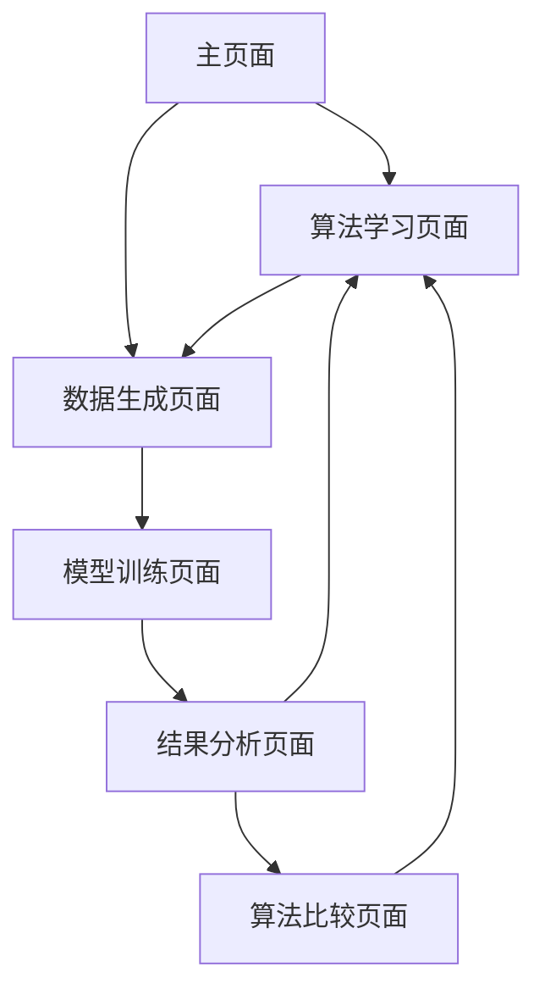

## 1. Product Overview

Python数据分类学习小程序是一个交互式机器学习教育工具，帮助用户理解和比较10种主流分类算法的原理、实现和应用。
- 通过可视化和实践操作，让用户深入理解机器学习算法的工作机制，适合学生、数据科学初学者和教育工作者使用。
- 项目旨在降低机器学习的学习门槛，提供直观的算法比较和性能分析工具。

## 2. Core Features

### 2.1 User Roles
本项目为单用户教育工具，无需用户注册和权限管理。

### 2.2 Feature Module

我们的Python数据分类学习小程序包含以下主要页面：
1. **主页面**：算法选择菜单、项目介绍、快速开始指南
2. **算法学习页面**：算法原理讲解、核心公式展示、参数说明
3. **数据生成页面**：随机数据生成、数据集可视化、数据预处理
4. **模型训练页面**：算法训练过程、参数调整、训练进度显示
5. **结果分析页面**：性能指标展示、可视化图表、模型比较
6. **算法比较页面**：多算法性能对比、适用场景总结、推荐建议

### 2.3 Page Details

| Page Name | Module Name | Feature description |
|-----------|-------------|---------------------|
| 主页面 | 算法选择菜单 | 展示10种分类算法列表，支持快速选择和搜索功能 |
| 主页面 | 项目介绍 | 显示项目功能概述、使用说明和学习目标 |
| 主页面 | 快速开始 | 提供新手引导和示例演示链接 |
| 算法学习页面 | 原理讲解 | 展示算法核心思想、数学原理和工作流程图 |
| 算法学习页面 | 公式展示 | 渲染数学公式、参数含义说明和计算步骤 |
| 算法学习页面 | 参数配置 | 提供算法超参数调整界面和参数影响说明 |
| 数据生成页面 | 数据生成器 | 创建不同分布的随机分类数据集，支持样本数量、特征维度、类别数量设置 |
| 数据生成页面 | 数据可视化 | 生成散点图、分布图展示数据特征和类别分布 |
| 数据生成页面 | 数据预处理 | 提供数据标准化、归一化和特征选择功能 |
| 模型训练页面 | 训练控制 | 启动训练、暂停、重置功能，显示训练进度和耗时 |
| 模型训练页面 | 实时监控 | 展示训练过程中的损失函数变化和准确率提升 |
| 模型训练页面 | 参数调优 | 支持网格搜索和随机搜索进行超参数优化 |
| 结果分析页面 | 性能指标 | 计算并展示准确率、精确率、召回率、F1分数、AUC等指标 |
| 结果分析页面 | 可视化图表 | 生成混淆矩阵、ROC曲线、学习曲线、决策边界图 |
| 结果分析页面 | 模型解释 | 提供特征重要性分析和模型决策过程可视化 |
| 算法比较页面 | 性能对比 | 并排显示多个算法的性能指标和运行时间 |
| 算法比较页面 | 适用场景 | 总结每个算法的优缺点、适用数据类型和实际应用案例 |
| 算法比较页面 | 推荐系统 | 根据数据特征自动推荐最适合的算法 |

## 3. Core Process

用户主要操作流程：
1. 进入主页面，浏览项目介绍和算法列表
2. 选择感兴趣的分类算法，进入算法学习页面了解原理
3. 前往数据生成页面，创建或选择合适的数据集
4. 在模型训练页面配置参数并启动训练过程
5. 查看结果分析页面的性能指标和可视化图表
6. 使用算法比较页面对比不同算法的表现
7. 重复步骤2-6，学习和比较其他算法

## 4. User Interface Design

### 4.1 Design Style

- **主色调**：深蓝色(#2563eb)作为主色，浅灰色(#f8fafc)作为背景色
- **辅助色**：绿色(#10b981)表示成功，红色(#ef4444)表示错误，橙色(#f59e0b)表示警告
- **按钮风格**：圆角矩形按钮，支持悬停效果和点击反馈
- **字体**：中文使用微软雅黑，英文使用Roboto，代码使用Consolas
- **字体大小**：标题18-24px，正文14-16px，代码12-14px
- **布局风格**：卡片式布局，左侧导航栏，主内容区域采用网格布局
- **图标风格**：线性图标风格，支持算法类型图标和功能操作图标

### 4.2 Page Design Overview

| Page Name | Module Name | UI Elements |
|-----------|-------------|-------------|
| 主页面 | 算法选择菜单 | 网格布局的算法卡片，每个卡片包含算法名称、简介和图标，支持搜索过滤 |
| 主页面 | 项目介绍 | Hero区域展示项目标题和描述，使用渐变背景和动画效果 |
| 算法学习页面 | 原理讲解 | 分栏布局，左侧文字说明，右侧流程图和示意图，支持步骤导航 |
| 算法学习页面 | 公式展示 | MathJax渲染的数学公式，配合参数说明表格和交互式计算器 |
| 数据生成页面 | 数据生成器 | 表单控件设置参数，实时预览数据分布，支持参数滑块和数值输入 |
| 数据生成页面 | 数据可视化 | Matplotlib/Plotly生成的交互式图表，支持缩放和数据点悬停 |
| 模型训练页面 | 训练控制 | 进度条显示训练状态，控制按钮组，参数配置面板 |
| 模型训练页面 | 实时监控 | 动态更新的折线图显示训练指标变化，支持多指标切换 |
| 结果分析页面 | 性能指标 | 指标卡片网格布局，数值高亮显示，支持指标解释弹窗 |
| 结果分析页面 | 可视化图表 | 多标签页展示不同类型图表，支持图表导出和全屏查看 |
| 算法比较页面 | 性能对比 | 对比表格和雷达图，支持算法选择和指标筛选 |

### 4.3 Responsiveness

项目采用桌面优先设计，主要面向PC端使用。考虑到数据可视化和复杂交互的需求，暂不考虑移动端适配。界面支持1920x1080及以上分辨率的最佳显示效果。