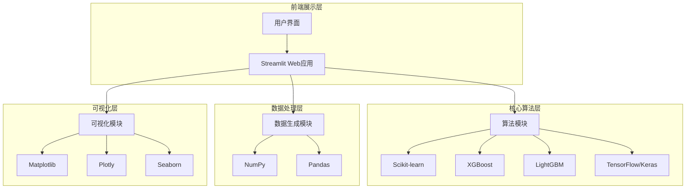
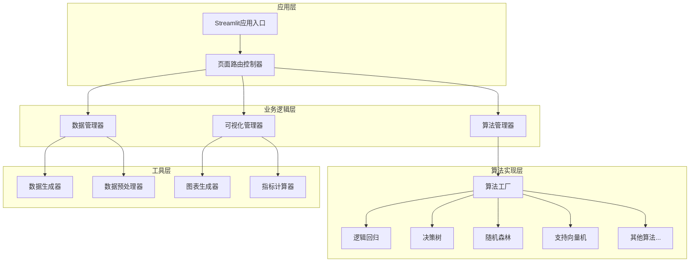
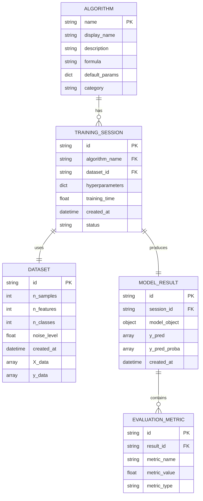

## 1. Architecture design



## 2. Technology Description

* **前端框架**: Streamlit - 快速构建数据科学Web应用

* **机器学习库**: Scikit-learn, XGBoost, LightGBM, TensorFlow/Keras

* **数据处理**: NumPy, Pandas

* **可视化**: Matplotlib, Plotly, Seaborn

* **数学公式渲染**: Streamlit-LaTeX

* **开发环境**: Python 3.8+, Jupyter Notebook(可选)

## 3. Route definitions

| Route                        | Purpose             |
| ---------------------------- | ------------------- |
| /                            | 主页面，显示项目介绍和算法选择菜单   |
| /algorithm/{algorithm\_name} | 算法学习页面，展示特定算法的原理和公式 |
| /data-generation             | 数据生成页面，创建和可视化训练数据   |
| /model-training              | 模型训练页面，配置参数并训练模型    |
| /results-analysis            | 结果分析页面，展示性能指标和可视化图表 |
| /algorithm-comparison        | 算法比较页面，对比多个算法的性能    |

## 4. API definitions

### 4.1 Core API

由于使用Streamlit框架，主要通过Python函数调用实现功能，无需传统REST API。

**算法训练接口**

```python
def train_algorithm(algorithm_name: str, X_train: np.ndarray, y_train: np.ndarray, params: dict) -> dict
```

参数说明:

| Param Name      | Param Type | isRequired | Description                                       |
| --------------- | ---------- | ---------- | ------------------------------------------------- |
| algorithm\_name | string     | true       | 算法名称 (logistic\_regression, decision\_tree, etc.) |
| X\_train        | np.ndarray | true       | 训练特征数据                                            |
| y\_train        | np.ndarray | true       | 训练标签数据                                            |
| params          | dict       | false      | 算法超参数配置                                           |

返回值:

| Param Name     | Param Type | Description |
| -------------- | ---------- | ----------- |
| model          | object     | 训练好的模型对象    |
| training\_time | float      | 训练耗时(秒)     |
| status         | string     | 训练状态        |

**数据生成接口**

```python
def generate_classification_data(n_samples: int, n_features: int, n_classes: int, noise: float) -> tuple
```

参数说明:

| Param Name  | Param Type | isRequired | Description |
| ----------- | ---------- | ---------- | ----------- |
| n\_samples  | int        | true       | 样本数量        |
| n\_features | int        | true       | 特征维度        |
| n\_classes  | int        | true       | 类别数量        |
| noise       | float      | false      | 噪声水平        |

**模型评估接口**

```python
def evaluate_model(model: object, X_test: np.ndarray, y_test: np.ndarray) -> dict
```

## 5. Server architecture diagram



## 6. Data model

### 6.1 Data model definition



### 6.2 Data Definition Language

由于使用Python内存存储和Streamlit session state，无需传统数据库DDL。以下为主要数据结构定义：

**算法配置数据结构**

```python
# 算法注册表
ALGORITHMS = {
    'logistic_regression': {
        'name': '逻辑回归',
        'description': '基于逻辑函数的线性分类算法',
        'formula': 'P(y=1|x) = 1/(1+e^(-wx-b))',
        'default_params': {'C': 1.0, 'max_iter': 100},
        'category': 'linear'
    },
    'decision_tree': {
        'name': '决策树',
        'description': '基于树形结构的分类算法',
        'formula': 'Gini = 1 - Σ(p_i)^2',
        'default_params': {'max_depth': 5, 'min_samples_split': 2},
        'category': 'tree'
    },
    # ... 其他算法配置
}
```

**数据集结构**

```python
# 数据集类定义
class Dataset:
    def __init__(self, X, y, name="Generated Dataset"):
        self.X = X  # 特征矩阵
        self.y = y  # 标签向量
        self.name = name
        self.n_samples, self.n_features = X.shape
        self.n_classes = len(np.unique(y))
        self.created_at = datetime.now()
```

**训练会话结构**

```python
# 训练会话类定义
class TrainingSession:
    def __init__(self, algorithm_name, dataset, hyperparameters):
        self.id = str(uuid.uuid4())
        self.algorithm_name = algorithm_name
        self.dataset = dataset
        self.hyperparameters = hyperparameters
        self.model = None
        self.training_time = 0
        self.status = 'initialized'
        self.created_at = datetime.now()
        self.metrics = {}
```

**评估指标结构**

```python
# 评估指标类定义
class EvaluationMetrics:
    def __init__(self, y_true, y_pred, y_pred_proba=None):
        self.accuracy = accuracy_score(y_true, y_pred)
        self.precision = precision_score(y_true, y_pred, average='weighted')
        self.recall = recall_score(y_true, y_pred, average='weighted')
        self.f1_score = f1_score(y_true, y_pred, average='weighted')
        if y_pred_proba is not None:
            self.auc_score = roc_auc_score(y_true, y_pred_proba, multi_class='ovr')
        self.confusion_matrix = confusion_matrix(y_true, y_pred)
```

