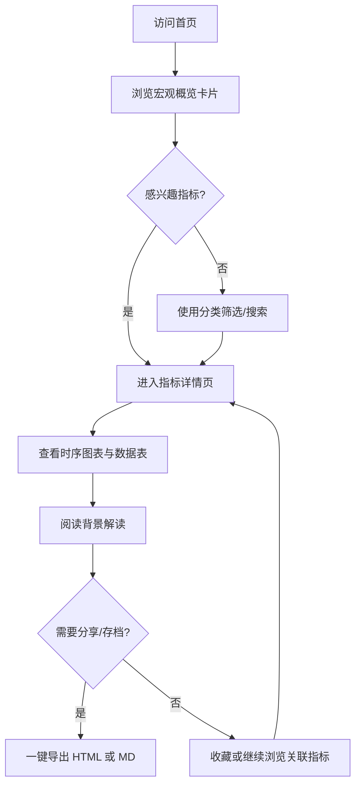
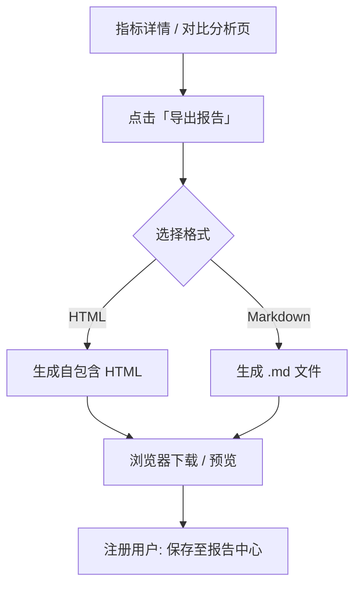

# 中国宏观经济分析网站 - 产品需求文档

## 1. 产品概述

中国宏观经济分析网站是一个面向政策研究者、金融从业者、企业战略部门及经济爱好者的**实时宏观数据可视化与分析平台**。平台聚合国家统计局、中国人民银行等权威数据源，以交互式图表呈现核心宏观指标，并为每个指标提供结构化的**背景解读与成因分析**，支持一键导出为 **HTML 自包含报告**或 **Markdown 文档**。

### 1.1 产品定位

| 维度 | 描述 |
|------|------|
| 目标用户 | 经济研究人员、投资分析师、企业战略/财务部门、高校师生、政策关注者 |
| 核心价值 | 一站式查看中国宏观数据、理解数据背后的政策与经济逻辑、快速生成可分享的分析报告 |
| 差异化 | 数据 + 图表 + 背景成因三位一体；导出文档可离线阅读、可直接嵌入汇报材料 |

### 1.2 产品目标

- **实时性**：核心指标在官方发布后 24 小时内更新，页面支持手动刷新与自动轮询
- **可读性**：非专业用户也能通过背景解读理解指标含义与变动原因
- **可导出**：任意分析视图可一键导出 HTML（含图表快照）或 MD（含数据表格）
- **可扩展**：指标模块插件化，便于后续增加区域对比、国际对比等功能

---

## 2. 核心功能

### 2.1 用户角色

| 角色 | 注册方式 | 核心权限 |
|------|----------|----------|
| 访客 | 无需注册 | 浏览公开指标、查看基础图表与解读、导出单次报告（限 3 次/天） |
| 注册用户 | 邮箱/手机注册 | 无限制导出、收藏指标、自定义仪表盘、历史快照对比 |
| 专业用户 | 订阅升级 | API 访问、批量导出、自定义指标组合报告、数据下载 CSV |
| 管理员 | 系统分配 | 指标配置、解读内容维护、数据源监控、缓存策略管理 |

> **MVP 阶段**：仅实现访客 + 注册用户两种角色，专业用户与管理员为二期功能。

### 2.2 功能模块总览

```
┌─────────────────────────────────────────────────────────────┐
│  宏观概览仪表盘  │  指标详情页  │  对比分析  │  报告中心  │
├─────────────────────────────────────────────────────────────┤
│  数据服务层（采集 / 缓存 / 计算）  │  解读知识库  │  导出引擎  │
└─────────────────────────────────────────────────────────────┘
```

### 2.3 页面与功能明细

| 页面 | 模块 | 功能描述 |
|------|------|----------|
| **首页 / 宏观概览** | 核心指标卡片 | 展示 GDP 增速、CPI、PPI、PMI、M2、LPR、社融、进出口等 8–12 个 headline 指标，含最新值、环比/同比、趋势箭头 |
| 首页 | 宏观热力图 | 按「增长 / 通胀 / 货币 / 外贸 / 就业」分类展示指标健康度（红/黄/绿） |
| 首页 | 近期要闻摘要 | 关联最新数据发布的政策背景一句话摘要 |
| **指标详情页** | 时序图表 | 支持折线/柱状/面积图，时间范围切换（1Y / 3Y / 5Y / 10Y / 全部），同比/环比切换 |
| 指标详情页 | 数据表格 | 可排序、可筛选的原始数据表，显示发布日期与修订标记 |
| 指标详情页 | **背景解读** | 指标定义、统计口径、历史区间对比、本次变动的主要驱动因素（结构化：政策面 / 需求面 / 供给面 / 外部因素） |
| 指标详情页 | 关联指标 | 展示与该指标高度相关的其他指标快捷跳转 |
| 指标详情页 | **一键导出** | 导出当前页面为 HTML 报告或 MD 文档（含图表、数据表、解读全文） |
| **对比分析页** | 多指标叠加 | 最多 4 个指标同图对比（支持双 Y 轴、归一化） |
| 对比分析页 | 时期对比 | 选择两个时间段进行均值/波动率/相关性对比 |
| 对比分析页 | 导出对比报告 | 一键导出 HTML / MD |
| **报告中心** | 我的报告 | 注册用户可查看历史导出记录与收藏的分析快照 |
| 报告中心 | 模板报告 | 预设「月度宏观速览」「通胀专题」「货币政策专题」等组合报告 |
| **设置页** | 偏好配置 | 默认时间范围、图表主题、自动刷新间隔、导出格式偏好 |

### 2.4 宏观指标覆盖范围（MVP）

| 分类 | 指标 | 数据源 | 更新频率 |
|------|------|--------|----------|
| 增长 | GDP（季度）、工业增加值、固定资产投资、社零总额 | 国家统计局 | 月/季 |
| 通胀 | CPI、PPI、核心 CPI | 国家统计局 | 月 |
| 景气 | 制造业 PMI、非制造业 PMI | 国家统计局 | 月 |
| 货币 | M0/M1/M2、社融规模、新增人民币贷款 | 中国人民银行 | 月 |
| 利率 | LPR（1Y/5Y）、MLF 利率、存款准备金率 | 中国人民银行 | 不定期 |
| 外贸 | 进出口总额、贸易顺差、外汇储备 | 海关总署 / 央行 | 月 |
| 就业 | 城镇调查失业率 | 国家统计局 | 月 |
| 房地产 | 70 城房价指数、商品房销售面积 | 国家统计局 | 月 |

### 2.5 背景解读内容结构

每个指标的解读模块采用统一模板，便于维护与导出：

```markdown
## {指标名称} — {最新期别} 解读

### 指标概要
- 最新值：{value} {unit}
- 变动：{change}（{direction}）
- 发布日期：{release_date}

### 指标说明
{50–100 字的指标定义与统计口径说明}

### 本次变动背景
#### 政策因素
{相关政策、央行操作、财政政策等}

#### 需求因素
{消费、投资、出口等需求侧驱动}

#### 供给因素
{产能、库存、原材料价格等供给侧驱动}

#### 外部因素
{国际大宗商品、汇率、地缘政治等}

### 历史参照
{与近 5 年均值、历史极值的对比描述}

### 展望与关注
{3–5 条后续需关注的催化剂或风险点}
```

解读内容来源：
1. **结构化知识库**（管理员维护的核心解读模板，按指标 + 期别更新）
2. **规则引擎自动生成**（基于数据变动幅度、阈值触发标准解读段落）
3. **LLM 辅助生成**（二期，基于数据变动自动生成草稿，人工审核后发布）

---

## 3. 核心用户流程

### 3.1 日常浏览流程



### 3.2 导出流程



### 3.3 对比分析流程

用户从概览页或详情页点击「加入对比」→ 对比分析页最多叠加 4 个指标 → 调整时间范围与归一化方式 → 查看相关性摘要 → 导出对比报告。

---

## 4. 导出功能需求

### 4.1 HTML 导出

| 要求 | 说明 |
|------|------|
| 自包含 | CSS 内联，图表转为 SVG/Canvas 快照嵌入，无需外部依赖即可离线打开 |
| 内容完整 | 含报告标题、生成时间、数据来源声明、图表、数据表、背景解读全文 |
| 样式 | 简洁专业，适合打印（A4 适配）与邮件附件 |
| 文件命名 | `宏观分析_{指标名}_{期别}_{YYYYMMDD}.html` |

### 4.2 Markdown 导出

| 要求 | 说明 |
|------|------|
| 兼容性 | 符合 CommonMark，可在 GitHub / Notion / Obsidian 中正常渲染 |
| 图表处理 | 图表导出为 PNG 图片（Base64 或相对路径），嵌入 `` |
| 数据表 | 标准 Markdown 表格，保留 2 位小数 |
| 元数据 | 文首 YAML front matter：`title`, `date`, `indicators`, `source` |
| 文件命名 | `宏观分析_{指标名}_{期别}_{YYYYMMDD}.md` |

### 4.3 导出范围选项

- **当前指标**：单个指标详情页全部内容
- **当前对比**：对比分析页的多指标组合
- **专题模板**：按预设模板打包多个指标（如「月度宏观速览」含 8 个核心指标）

---

## 5. 非功能需求

### 5.1 性能

| 指标 | 目标 |
|------|------|
| 首页加载 | ≤ 2s（缓存命中） |
| 图表渲染 | ≤ 500ms（单指标 10 年数据） |
| 导出生成 | ≤ 3s（单指标 HTML/MD） |
| 数据刷新 | 后端定时任务 + 前端 5 分钟可选自动轮询 |

### 5.2 可用性

- 响应式设计：桌面优先，兼容平板（768px+）
- 支持深色/浅色主题切换
- 图表支持缩放、数据点悬停 tooltip、图例切换
- 全站中文界面，专业术语附带 tooltip 解释

### 5.3 数据准确性

- 所有数据标注来源与发布日期
- 数据修订时保留修订历史，图表标注「已修订」标记
- 页面底部免责声明：「数据仅供参考，不构成投资建议」

### 5.4 安全与合规

- 不采集用户敏感个人信息（MVP 阶段）
- 导出文件不含用户隐私信息
- 遵守数据源使用条款，注明「数据来源：国家统计局」等

---

## 6. 用户界面设计

### 6.1 设计风格

| 元素 | 规范 |
|------|------|
| 主色调 | 深蓝 `#1E3A5F`（专业、稳重）+ 强调色琥珀 `#F59E0B`（数据高亮） |
| 图表色板 | 色盲友好 8 色序列，正增长绿 `#059669`、负增长红 `#DC2626` |
| 字体 | 中文：思源黑体 / Noto Sans SC；数字：JetBrains Mono |
| 布局 | 左侧固定导航（指标分类树）+ 右侧内容区，卡片式模块 |
| 图标 | Lucide Icons，线性风格 |

### 6.2 关键页面线框描述

**宏观概览页**
- 顶部：全局搜索栏 + 最后更新时间 + 刷新按钮
- 第一行：4 个 KPI 大卡片（GDP / CPI / PMI / M2）
- 第二行：分类指标网格（每类 3–4 个小卡片）
- 第三行：「宏观形势速评」文字摘要区 + 「导出月度速览」按钮

**指标详情页**
- 左侧 60%：主时序图表 + 时间范围工具栏
- 右侧 40%：最新值摘要卡片 + 变动原因标签云
- 下方全宽：背景解读（Tab：政策/需求/供给/外部）+ 数据表
- 固定右下角 FAB：「导出 HTML」「导出 MD」

### 6.3 响应式策略

| 断点 | 布局调整 |
|------|----------|
| ≥ 1280px | 完整左侧导航 + 双栏详情页 |
| 768–1279px | 可折叠左侧导航，详情页单栏堆叠 |
| < 768px | 底部 Tab 导航，卡片单列，图表全宽 |

---

## 7. 版本规划

### 7.1 MVP（v1.0）

- [ ] 8 个核心指标的数据采集与展示
- [ ] 宏观概览页 + 指标详情页
- [ ] 基础背景解读（规则引擎 + 静态知识库）
- [ ] HTML / MD 单指标导出
- [ ] 深色/浅色主题

### 7.2 v1.1

- [ ] 对比分析页（多指标叠加）
- [ ] 用户注册/收藏/报告中心
- [ ] 专题模板导出（月度宏观速览）
- [ ] 扩展至 15+ 指标

### 7.3 v2.0

- [ ] 省际/城市级区域对比
- [ ] LLM 辅助解读生成
- [ ] 国际宏观对比（中美欧）
- [ ] 专业用户 API 与 CSV 批量下载
- [ ] 数据异常监控与告警订阅

---

## 8. 成功指标

| 指标 | MVP 目标 |
|------|----------|
| 指标覆盖率 | ≥ 8 个核心宏观指标 |
| 数据延迟 | 官方发布后 ≤ 24h 更新 |
| 导出成功率 | ≥ 99% |
| 页面加载 | P95 ≤ 2s |
| 解读完整率 | 每个指标 ≥ 4 个背景维度有内容 |

---

## 9. 风险与约束

| 风险 | 影响 | 缓解措施 |
|------|------|----------|
| 官方数据源接口不稳定 | 数据更新延迟 | 多数据源备份（AKShare + 官方 API）；本地缓存最后一期 |
| 解读内容维护成本高 | 内容滞后 | MVP 用规则引擎 + 模板；二期引入 LLM 辅助 |
| 宏观数据修订 | 历史图表不一致 | 版本化存储，标注修订记录 |
| 非专业用户理解门槛 | 用户流失 | 术语 tooltip + 结构化解读 + 指标准入门指南 |

---

## 10. 术语表

| 术语 | 说明 |
|------|------|
| CPI | 居民消费价格指数，衡量通胀水平 |
| PPI | 工业生产者出厂价格指数 |
| PMI | 采购经理指数，>50 表示扩张 |
| M2 | 广义货币供应量 |
| LPR | 贷款市场报价利率 |
| 社融 | 社会融资规模，衡量实体经济融资总量 |
| 同比 | 与去年同期相比 |
| 环比 | 与上一期相比 |
