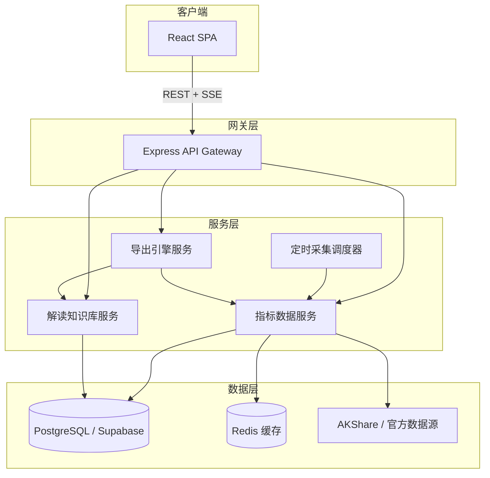
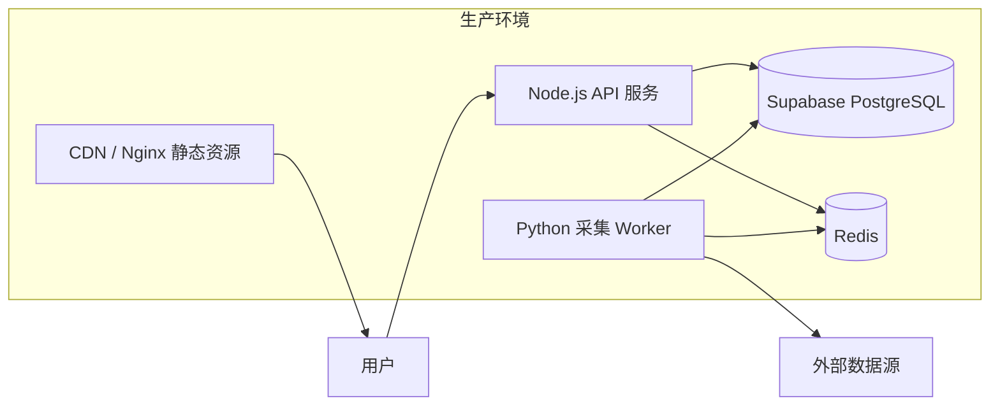
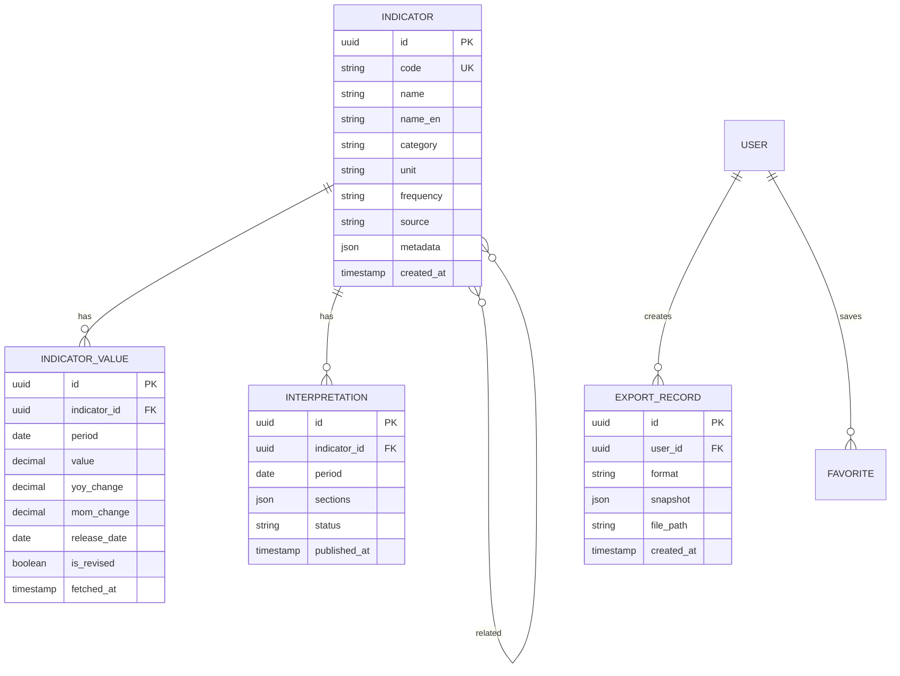
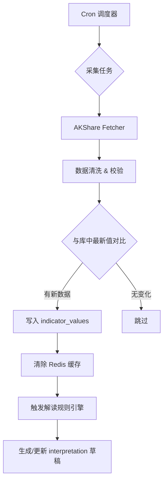
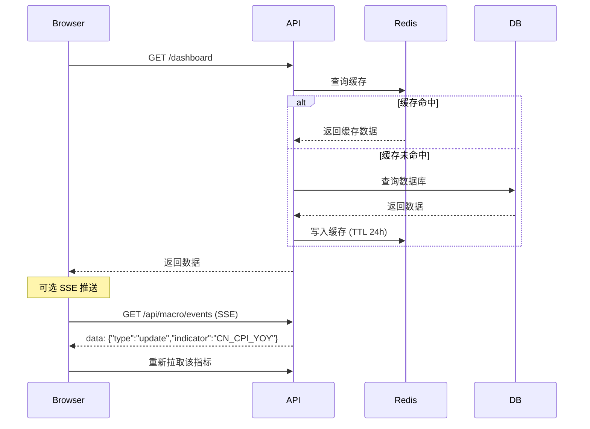
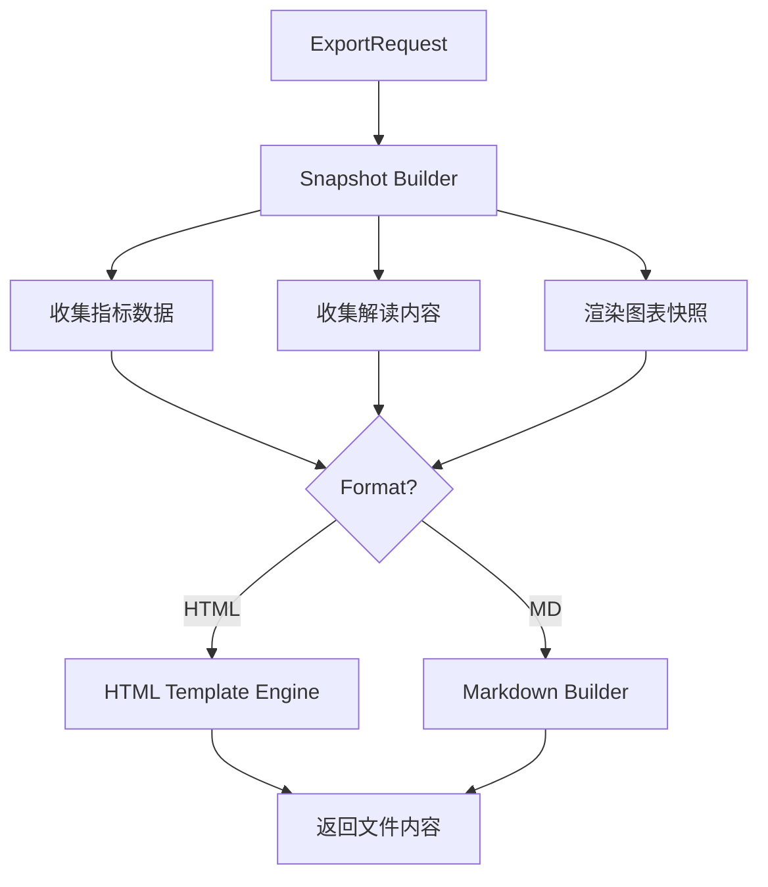
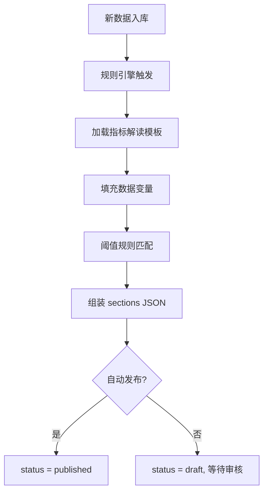

# 中国宏观经济分析网站 - 技术架构文档

## 1. 架构设计

### 1.1 系统架构总览



### 1.2 架构原则

| 原则 | 说明 |
|------|------|
| 前后端分离 | React SPA + RESTful API，便于独立部署与扩展 |
| 缓存优先 | 宏观数据更新频率低（月/季），Redis 缓存 + 前端 SWR 策略 |
| 模块化指标 | 每个指标独立 Adapter，新增指标只需添加配置与 Adapter |
| 导出无状态 | 导出服务基于请求快照生成文件，不持久化中间产物 |
| 可渐进增强 | MVP 可用 Mock 数据 + AKShare，后续接入官方 API |

### 1.3 部署架构



---

## 2. 技术选型

### 2.1 技术栈

| 层级 | 技术 | 版本 | 选型理由 |
|------|------|------|----------|
| 前端框架 | React + TypeScript | 18.x / 5.x | 与现有仓库技术栈一致，生态成熟 |
| 构建工具 | Vite | 6.x | 快速 HMR，现有项目已配置 |
| 样式 | Tailwind CSS | 3.x | 实用优先，快速构建专业 UI |
| 图表库 | ECharts + echarts-for-react | 5.x | 金融时序图表能力强，内置 dataZoom |
| 状态管理 | Zustand | 5.x | 轻量，现有项目已使用 |
| 数据请求 | TanStack Query (React Query) | 5.x | 缓存、轮询、Stale-While-Revalidate |
| 路由 | React Router | 7.x | 现有项目已使用 |
| 后端框架 | Express + TypeScript | 4.x | 与现有 API 层一致 |
| 数据采集 | Python + AKShare | 3.11 / latest | 中国金融宏观数据覆盖全面 |
| 数据库 | Supabase (PostgreSQL) | - | 现有项目已集成 |
| 缓存 | Redis | 7.x | 宏观数据缓存、采集锁 |
| 导出 HTML | 自研模板引擎 + Puppeteer（可选） | - | MVP 用模板字符串 + 内联 CSS |
| 导出 MD | 自研 Markdown Builder | - | 轻量，无额外依赖 |

### 2.2 目录结构（新增模块）

```
/workspace
├── macro/                          # 宏观经济分析模块（新增）
│   ├── frontend/                   # 前端页面与组件
│   │   ├── pages/
│   │   │   ├── MacroDashboard.tsx      # 宏观概览
│   │   │   ├── IndicatorDetail.tsx     # 指标详情
│   │   │   ├── CompareAnalysis.tsx     # 对比分析
│   │   │   └── ReportCenter.tsx        # 报告中心
│   │   ├── components/
│   │   │   ├── IndicatorCard.tsx       # 指标卡片
│   │   │   ├── TimeSeriesChart.tsx     # 时序图表
│   │   │   ├── InterpretationPanel.tsx # 背景解读面板
│   │   │   ├── ExportButton.tsx        # 导出按钮组
│   │   │   └── DataTable.tsx           # 数据表格
│   │   ├── hooks/
│   │   │   ├── useIndicator.ts         # 指标数据 Hook
│   │   │   └── useExport.ts            # 导出 Hook
│   │   └── stores/
│   │       └── macroStore.ts           # 宏观数据状态
│   ├── api/                        # 后端 API 路由
│   │   ├── routes/
│   │   │   ├── indicators.ts           # 指标 CRUD
│   │   │   ├── interpretations.ts        # 解读内容
│   │   │   └── export.ts               # 导出接口
│   │   ├── services/
│   │   │   ├── indicatorService.ts     # 指标业务逻辑
│   │   │   ├── interpretationService.ts
│   │   │   └── exportService.ts        # HTML/MD 生成
│   │   └── adapters/                   # 数据源适配器
│   │       ├── baseAdapter.ts
│   │       ├── gdpAdapter.ts
│   │       ├── cpiAdapter.ts
│   │       └── ...
│   ├── collector/                  # Python 数据采集
│   │   ├── main.py                     # 调度入口
│   │   ├── fetchers/                   # 各指标采集脚本
│   │   │   ├── akshare_gdp.py
│   │   │   ├── akshare_cpi.py
│   │   │   └── ...
│   │   └── requirements.txt
│   └── data/
│       ├── indicators.json             # 指标元数据配置
│       └── interpretations/            # 解读模板（JSON/YAML）
├── src/                            # 现有前端（集成入口）
└── api/                            # 现有后端（挂载 macro 路由）
```

---

## 3. 数据模型

### 3.1 ER 关系



### 3.2 核心表结构

**indicators — 指标元数据**

```sql
CREATE TABLE indicators (
  id            UUID PRIMARY KEY DEFAULT gen_random_uuid(),
  code          VARCHAR(50) UNIQUE NOT NULL,  -- 如 'CN_GDP_YOY'
  name          VARCHAR(100) NOT NULL,         -- 如 'GDP累计同比'
  name_en       VARCHAR(100),
  category      VARCHAR(30) NOT NULL,          -- growth/inflation/monetary/trade/employment
  unit          VARCHAR(20) NOT NULL,          -- %, 亿元, 点
  frequency     VARCHAR(10) NOT NULL,          -- monthly/quarterly/yearly
  source        VARCHAR(100) NOT NULL,
  description   TEXT,
  metadata      JSONB DEFAULT '{}',
  created_at    TIMESTAMPTZ DEFAULT NOW()
);
```

**indicator_values — 时序数据**

```sql
CREATE TABLE indicator_values (
  id            UUID PRIMARY KEY DEFAULT gen_random_uuid(),
  indicator_id  UUID REFERENCES indicators(id),
  period        DATE NOT NULL,
  value         NUMERIC(18,4) NOT NULL,
  yoy_change    NUMERIC(8,4),
  mom_change    NUMERIC(8,4),
  release_date  DATE,
  is_revised    BOOLEAN DEFAULT FALSE,
  fetched_at    TIMESTAMPTZ DEFAULT NOW(),
  UNIQUE(indicator_id, period)
);
CREATE INDEX idx_values_indicator_period ON indicator_values(indicator_id, period DESC);
```

**interpretations — 背景解读**

```sql
CREATE TABLE interpretations (
  id            UUID PRIMARY KEY DEFAULT gen_random_uuid(),
  indicator_id  UUID REFERENCES indicators(id),
  period        DATE NOT NULL,
  sections      JSONB NOT NULL,
  -- sections 结构:
  -- {
  --   "summary": "...",
  --   "policy": ["..."],
  --   "demand": ["..."],
  --   "supply": ["..."],
  --   "external": ["..."],
  --   "outlook": ["..."]
  -- }
  status        VARCHAR(20) DEFAULT 'draft',  -- draft/published
  published_at  TIMESTAMPTZ,
  UNIQUE(indicator_id, period)
);
```

---

## 4. 数据源与采集

### 4.1 数据源映射

| 指标 | AKShare 接口 | 官方来源 | 频率 |
|------|-------------|----------|------|
| GDP 同比 | `macro_china_gdp_yearly` | 国家统计局 | 季 |
| CPI 同比 | `macro_china_cpi_yearly` | 国家统计局 | 月 |
| PPI 同比 | `macro_china_ppi_yearly` | 国家统计局 | 月 |
| 制造业 PMI | `macro_china_pmi_yearly` | 国家统计局 | 月 |
| M2 同比 | `macro_china_m2_yearly` | 中国人民银行 | 月 |
| LPR | `macro_china_lpr` | 中国人民银行 | 月 |
| 社融 | `macro_china_shrzgm` | 中国人民银行 | 月 |
| 进出口 | `macro_china_trade_balance` | 海关总署 | 月 |

### 4.2 采集调度



**调度策略：**

| 任务 | Cron 表达式 | 说明 |
|------|-------------|------|
| 月度指标采集 | `0 10 1,15,28 * *` | 每月 1/15/28 日上午 10 点 |
| 季度 GDP 采集 | `0 10 1 1,4,7,10 *` | 季度首月 1 日 |
| 缓存预热 | 采集完成后立即 | 写入 Redis，TTL 24h |
| 健康检查 | `0 */6 * * *` | 每 6 小时检查数据源可用性 |

### 4.3 数据清洗规则

```typescript
interface CleanRule {
  // 缺失值：线性插值（仅用于图表展示，原始表保留 null）
  missingValueStrategy: 'null' | 'interpolate';
  // 异常值：超出 3σ 标记但不删除
  outlierDetection: boolean;
  // 精度：保留 2 位小数（百分比）或 4 位（绝对值）
  precision: number;
  // 同比/环比：自动计算并校验与源数据一致性
  autoCalcChange: boolean;
}
```

---

## 5. API 设计

### 5.1 路由总览

| Method | Path | 描述 |
|--------|------|------|
| GET | `/api/macro/indicators` | 获取指标列表（支持 category 筛选） |
| GET | `/api/macro/indicators/:code` | 获取单个指标元数据 |
| GET | `/api/macro/indicators/:code/values` | 获取时序数据（支持 start/end/limit） |
| GET | `/api/macro/indicators/:code/interpretation` | 获取最新或指定期别解读 |
| GET | `/api/macro/indicators/:code/related` | 获取关联指标 |
| GET | `/api/macro/dashboard` | 获取概览页聚合数据 |
| POST | `/api/macro/compare` | 多指标对比数据 |
| POST | `/api/macro/export/html` | 导出 HTML 报告 |
| POST | `/api/macro/export/markdown` | 导出 Markdown 报告 |
| GET | `/api/macro/export/templates` | 获取预设导出模板列表 |
| GET | `/api/macro/meta/last-updated` | 获取全局最后更新时间 |

### 5.2 核心 API 详细定义

#### 获取指标时序数据

```
GET /api/macro/indicators/:code/values?start=2020-01-01&end=2025-08-01&limit=120
```

Response:

```json
{
  "success": true,
  "data": {
    "indicator": {
      "code": "CN_CPI_YOY",
      "name": "CPI同比",
      "unit": "%",
      "frequency": "monthly"
    },
    "values": [
      {
        "period": "2025-07-01",
        "value": 0.5,
        "yoy_change": 0.5,
        "mom_change": 0.2,
        "release_date": "2025-08-09",
        "is_revised": false
      }
    ],
    "meta": {
      "count": 67,
      "last_updated": "2025-08-09T10:30:00Z"
    }
  }
}
```

#### 获取概览仪表盘

```
GET /api/macro/dashboard
```

Response:

```json
{
  "success": true,
  "data": {
    "headline": [
      {
        "code": "CN_GDP_YOY",
        "name": "GDP累计同比",
        "latest_value": 5.2,
        "unit": "%",
        "change": 0.1,
        "direction": "up",
        "period": "2025-Q2",
        "sparkline": [4.5, 4.7, 5.0, 5.2]
      }
    ],
    "categories": {
      "growth": [...],
      "inflation": [...],
      "monetary": [...],
      "trade": [...]
    },
    "summary": "2025年二季度GDP同比增长5.2%，经济运行总体平稳...",
    "last_updated": "2025-08-09T10:30:00Z"
  }
}
```

#### 导出 HTML 报告

```
POST /api/macro/export/html
Content-Type: application/json
```

Request:

```json
{
  "type": "single",
  "indicators": ["CN_CPI_YOY"],
  "period": "2025-07-01",
  "options": {
    "include_chart": true,
    "include_table": true,
    "include_interpretation": true,
    "theme": "light"
  }
}
```

Response:

```json
{
  "success": true,
  "data": {
    "filename": "宏观分析_CPI同比_202507_20250824.html",
    "content": "<!DOCTYPE html>...",
    "size_bytes": 125000
  }
}
```

#### 导出 Markdown 报告

```
POST /api/macro/export/markdown
```

Request: 同上

Response:

```json
{
  "success": true,
  "data": {
    "filename": "宏观分析_CPI同比_202507_20250824.md",
    "content": "---\ntitle: CPI同比分析\n...",
    "size_bytes": 8500
  }
}
```

### 5.3 实时更新机制



| 策略 | 实现 |
|------|------|
| 前端轮询 | React Query `refetchInterval: 300000`（5 分钟，用户可配置） |
| 手动刷新 | 按钮触发 `refetch()` + 显示最后更新时间 |
| SSE 推送（v1.1） | 采集完成后推送 `{type: 'update', codes: [...]}` |
| Stale-While-Revalidate | 先展示缓存数据，后台静默刷新 |

---

## 6. 导出引擎设计

### 6.1 导出架构



### 6.2 HTML 导出模板结构

```html
<!DOCTYPE html>
<html lang="zh-CN">
<head>
  <meta charset="UTF-8">
  <title>{title}</title>
  <style>/* 内联 CSS：排版、表格、打印适配 */</style>
</head>
<body>
  <header>
    <h1>{title}</h1>
    <p class="meta">生成时间：{generated_at} | 数据来源：{source}</p>
  </header>

  <section class="summary">
    <div class="kpi">{latest_value} {unit}</div>
    <div class="change {direction}">{change_label}</div>
  </section>

  <section class="chart">
    
  </section>

  <section class="interpretation">
    <h2>背景解读</h2>
    <!-- 各维度解读段落 -->
  </section>

  <section class="data-table">
    <h2>历史数据</h2>
    <table>...</table>
  </section>

  <footer>
    <p class="disclaimer">免责声明：本报告数据仅供参考，不构成投资建议。</p>
  </footer>
</body>
</html>
```

### 6.3 Markdown 导出模板结构

```markdown
---
title: "{title}"
date: {generated_at}
indicators: [{codes}]
source: "国家统计局 / 中国人民银行"
---

# {title}

> 生成时间：{generated_at}

## 核心摘要

| 指标 | 最新值 | 变动 | 期别 |
|------|--------|------|------|
| {name} | {value} {unit} | {change} | {period} |

## 时序图表


## 背景解读

### 政策因素
{policy_content}

### 需求因素
{demand_content}

### 供给因素
{supply_content}

### 外部因素
{external_content}

### 展望与关注
{outlook_content}

## 历史数据

| 期别 | 数值 | 同比 | 环比 |
|------|------|------|------|
| ... | ... | ... | ... |

---

*免责声明：本报告数据仅供参考，不构成投资建议。*
```

### 6.4 图表快照方案

| 方案 | 优点 | 缺点 | MVP 选择 |
|------|------|------|----------|
| 前端 Canvas toDataURL | 无后端依赖，速度快 | 需前端发起导出 | **✓ MVP 采用** |
| 后端 Puppeteer 渲染 | 一致性好 | 资源消耗大，部署复杂 | v1.1 备选 |
| ECharts getDataURL | 原生支持，SVG/PNG | 仅 ECharts 可用 | **✓ MVP 采用** |

**MVP 导出流程（前端主导）：**

1. 用户点击「导出」按钮
2. 前端调用 `chartRef.getEchartsInstance().getDataURL()` 获取 PNG Base64
3. 前端组装完整 HTML/MD 字符串（模板 + 数据 + 图表）
4. 通过 `Blob` + `URL.createObjectURL` 触发浏览器下载
5. （可选）同时 POST 到后端保存至报告中心

---

## 7. 解读知识库与规则引擎

### 7.1 解读生成流程



### 7.2 规则引擎示例

```typescript
interface InterpretRule {
  indicator_code: string;
  condition: {
    field: 'yoy_change' | 'value' | 'mom_change';
    operator: 'gt' | 'lt' | 'between' | 'crosses';
    value: number | [number, number];
  };
  template: {
    section: 'policy' | 'demand' | 'supply' | 'external' | 'outlook';
    text: string; // 支持 {{value}}, {{period}}, {{change}} 变量
  };
}

// 示例规则
const cpiRules: InterpretRule[] = [
  {
    indicator_code: 'CN_CPI_YOY',
    condition: { field: 'yoy_change', operator: 'gt', value: 3.0 },
    template: {
      section: 'policy',
      text: '{{period}}CPI同比升至{{value}}%，超过3%通胀警戒线，货币政策可能面临收紧压力。'
    }
  },
  {
    indicator_code: 'CN_CPI_YOY',
    condition: { field: 'yoy_change', operator: 'lt', value: 1.0 },
    template: {
      section: 'policy',
      text: '{{period}}CPI同比仅{{value}}%，通缩风险值得关注，政策有望保持宽松。'
    }
  }
];
```

### 7.3 解读模板存储

```
macro/data/interpretations/
├── CN_GDP_YOY/
│   ├── base.json          # 指标基础说明（不随期别变化）
│   └── rules.json         # 阈值规则列表
├── CN_CPI_YOY/
│   ├── base.json
│   └── rules.json
└── ...
```

---

## 8. 前端组件设计

### 8.1 组件树

```
MacroDashboard
├── DashboardHeader (搜索 / 刷新 / 更新时间)
├── HeadlineCards (KPI 大卡片 × 4)
├── CategoryGrid
│   └── IndicatorCard × N
├── MacroSummary (速评文字)
└── QuickExportButton

IndicatorDetail
├── DetailHeader (面包屑 / 标题 / 导出按钮)
├── ChartSection
│   ├── TimeRangeSelector
│   ├── ChartToolbar (图表类型 / 同比环比)
│   └── TimeSeriesChart (ECharts)
├── SidePanel
│   ├── LatestValueCard
│   └── ChangeReasonTags
├── InterpretationPanel
│   ├── SectionTabs (政策/需求/供给/外部/展望)
│   └── SectionContent
├── RelatedIndicators
└── DataTable

ExportButton
├── FormatSelector (HTML / MD)
├── ScopeSelector (当前指标 / 含表格 / 含解读)
└── DownloadTrigger
```

### 8.2 关键 Hook

```typescript
// useIndicator — 获取指标数据（React Query）
function useIndicator(code: string, range?: DateRange) {
  return useQuery({
    queryKey: ['indicator', code, range],
    queryFn: () => api.getIndicatorValues(code, range),
    staleTime: 5 * 60 * 1000,
    refetchInterval: 5 * 60 * 1000,
  });
}

// useExport — 导出功能
function useExport() {
  const exportHtml = async (snapshot: ExportSnapshot) => {
    const chartImage = chartRef.current?.getEchartsInstance().getDataURL({
      type: 'png', pixelRatio: 2, backgroundColor: '#fff'
    });
    const html = buildHtmlReport({ ...snapshot, chartImage });
    downloadBlob(html, `${snapshot.filename}.html`, 'text/html');
  };

  const exportMarkdown = async (snapshot: ExportSnapshot) => { /* 同理 */ };

  return { exportHtml, exportMarkdown };
}
```

---

## 9. 缓存策略

| 缓存层 | Key 模式 | TTL | 失效触发 |
|--------|----------|-----|----------|
| Redis | `macro:indicator:{code}:values` | 24h | 采集写入新数据 |
| Redis | `macro:dashboard` | 1h | 任一 headline 指标更新 |
| Redis | `macro:interpretation:{code}:{period}` | 7d | 解读发布/更新 |
| 前端 (React Query) | `['indicator', code, range]` | 5min stale | 手动刷新 / 轮询 |
| CDN | 静态资源 | 30d | 版本 hash 变更 |

---

## 10. 安全设计

| 方面 | 措施 |
|------|------|
| API 限流 | 导出接口 10 req/min/IP；数据接口 60 req/min/IP |
| 输入校验 | Zod schema 校验所有 API 参数 |
| XSS 防护 | 解读内容 HTML 转义；导出模板无用户输入拼接 |
| CORS | 仅允许配置的前端域名 |
| 数据完整性 | 采集写入前校验数值范围；revision 标记 |

---

## 11. 测试策略

| 类型 | 覆盖范围 | 工具 |
|------|----------|------|
| 单元测试 | Adapter 清洗逻辑、规则引擎、导出模板生成 | Vitest |
| 集成测试 | API 路由 + 数据库 | Supertest |
| E2E 测试 | 概览页加载 → 详情页 → 导出下载 | Playwright |
| 数据校验 | 采集数据与 AKShare 源一致性 | Python pytest |

---

## 12. 开发阶段与里程碑

### Phase 1：基础框架（Week 1-2）

- [ ] 项目目录结构搭建（`macro/` 模块）
- [ ] 数据库表创建与指标元数据 seed
- [ ] Python 采集脚本（GDP/CPI/PMI/M2 四个指标）
- [ ] 后端 API 骨架（indicators / values / dashboard）
- [ ] 前端路由注册与概览页骨架

### Phase 2：核心功能（Week 3-4）

- [ ] 指标详情页 + ECharts 时序图
- [ ] 背景解读面板（静态模板 + 规则引擎）
- [ ] HTML / MD 导出功能
- [ ] Redis 缓存集成
- [ ] 扩展至 8 个指标

### Phase 3：体验优化（Week 5-6）

- [ ] 对比分析页
- [ ] 深色/浅色主题
- [ ] 响应式适配
- [ ] 用户收藏与报告中心
- [ ] 专题模板导出

### Phase 4：上线准备

- [ ] E2E 测试覆盖核心流程
- [ ] 性能优化（缓存命中率 > 90%）
- [ ] 部署配置（Docker Compose / Vercel + Railway）
- [ ] 监控告警（采集失败 / API 错误率）

---

## 13. 环境配置

### 13.1 环境变量

```env
# 数据库
SUPABASE_URL=https://xxx.supabase.co
SUPABASE_SERVICE_KEY=xxx

# Redis
REDIS_URL=redis://localhost:6379

# 宏观模块
MACRO_CACHE_TTL=86400
MACRO_REFETCH_INTERVAL=300000
MACRO_EXPORT_RATE_LIMIT=10

# Python 采集
AKSHARE_TIMEOUT=30
COLLECTOR_CRON_MONTHLY="0 10 1,15,28 * *"
```

### 13.2 本地开发启动

```bash
# 1. 安装依赖
npm install
cd macro/collector && pip install -r requirements.txt

# 2. 初始化数据库
npm run macro:seed

# 3. 首次采集
npm run macro:collect

# 4. 启动开发服务
npm run dev
```

---

## 14. 监控与运维

| 监控项 | 工具 | 告警条件 |
|--------|------|----------|
| 采集任务成功率 | 日志 + Cron 状态 | 连续 2 次失败 |
| API 响应时间 | Express 中间件 | P95 > 2s |
| 缓存命中率 | Redis INFO | < 80% |
| 数据新鲜度 | 最后更新时间检查 | 超期 48h 未更新 |
| 导出失败率 | 导出 API 日志 | > 1% |

---

## 15. 附录

### 15.1 指标元数据配置示例

```json
{
  "code": "CN_CPI_YOY",
  "name": "CPI同比",
  "name_en": "CPI YoY",
  "category": "inflation",
  "unit": "%",
  "frequency": "monthly",
  "source": "国家统计局",
  "description": "居民消费价格指数（Consumer Price Index）反映居民家庭一般所购买消费品和服务项目价格水平变动情况。",
  "related": ["CN_PPI_YOY", "CN_CORE_CPI_YOY"],
  "chart_config": {
    "type": "line",
    "yAxis": { "min": "auto", "unit": "%" },
    "reference_lines": [
      { "value": 3.0, "label": "通胀警戒线", "color": "#DC2626" }
    ]
  }
}
```

### 15.2 技术决策记录

| 决策 | 选项 | 选择 | 理由 |
|------|------|------|------|
| 图表库 | Chart.js vs ECharts | ECharts | 金融时序图表功能更强，dataZoom 内置 |
| 数据采集 | 纯 Node vs Python | Python (AKShare) | AKShare 是中国宏观数据最全面的开源库 |
| 导出方式 | 纯后端 vs 前端主导 | 前端主导 (MVP) | 减少后端依赖，降低部署复杂度 |
| 解读生成 | 纯人工 vs 规则引擎 | 规则引擎 + 模板 (MVP) | 平衡质量与维护成本 |
| 模块位置 | 独立项目 vs 现有仓库子模块 | 现有仓库 `macro/` 子模块 | 复用现有 React + Express 基础设施 |
