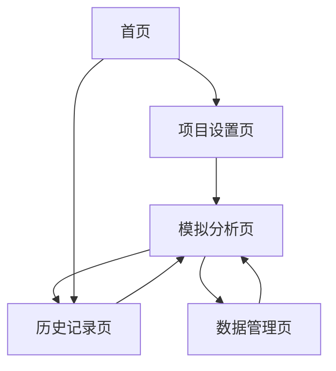

# 投标价格模拟器 - 产品需求文档

## 1. Product Overview
投标价格模拟器是一个智能化的投标决策支持系统，帮助企业在投标过程中制定最优价格策略。
- 通过输入项目信息和竞争环境参数，系统能够模拟不同投标价格下的中标概率和预期收益，为企业提供科学的投标决策依据。
- 目标用户为建筑、工程、咨询等行业的投标企业，帮助提高中标率和项目盈利能力。

## 2. Core Features

### 2.1 User Roles
| Role | Registration Method | Core Permissions |
|------|---------------------|------------------|
| 普通用户 | 邮箱注册 | 基础模拟功能，查看个人历史记录 |
| 企业用户 | 企业认证升级 | 高级分析功能，团队协作，数据导出 |
| 管理员 | 系统分配 | 用户管理，系统配置，数据维护 |

### 2.2 Feature Module
我们的投标价格模拟器包含以下主要页面：
1. **首页**：产品介绍、功能导航、快速开始模拟
2. **项目设置页**：项目基本信息录入、参数配置
3. **模拟分析页**：价格策略设置、模拟结果展示、概率分析
4. **历史记录页**：历史模拟记录、数据对比分析
5. **数据管理页**：行业数据维护、模型参数调整

### 2.3 Page Details
| Page Name | Module Name | Feature description |
|-----------|-------------|---------------------|
| 首页 | 产品介绍区 | 展示产品核心价值、功能亮点、使用流程说明 |
| 首页 | 快速模拟入口 | 提供简化版模拟器，支持快速体验核心功能 |
| 项目设置页 | 项目信息录入 | 输入项目名称、规模、类型、预算范围、工期要求、地区信息 |
| 项目设置页 | 竞争环境设置 | 设置竞争对手数量、实力等级、历史中标价格区间 |
| 项目设置页 | 成本参数配置 | 录入材料成本、人工成本、管理费用、预期利润率 |
| 模拟分析页 | 价格策略设置 | 设置投标价格范围、价格步长、多种定价策略对比 |
| 模拟分析页 | 模拟计算引擎 | 基于概率模型计算不同价格下的中标概率和预期收益 |
| 模拟分析页 | 结果可视化 | 图表展示中标概率曲线、收益分析、风险评估 |
| 模拟分析页 | 策略推荐 | 基于模拟结果推荐最优投标价格和策略建议 |
| 历史记录页 | 记录管理 | 查看、编辑、删除历史模拟记录，支持分类筛选 |
| 历史记录页 | 趋势分析 | 分析历史投标成功率、价格趋势、行业变化 |
| 历史记录页 | 数据导出 | 支持Excel、PDF格式导出分析报告 |
| 数据管理页 | 行业数据库 | 维护不同行业、地区的历史投标数据和价格指数 |
| 数据管理页 | 模型参数调整 | 调整概率计算模型参数，优化预测准确性 |

## 3. Core Process

**主要用户操作流程：**
用户首先在项目设置页录入项目基本信息，包括项目规模、类型、预算等关键参数，然后设置竞争环境和成本结构。接下来进入模拟分析页，设定不同的投标价格策略，系统自动计算各价格点的中标概率和预期收益。用户可以通过可视化图表分析结果，获得最优价格建议。所有模拟记录自动保存到历史记录页，支持后续的趋势分析和数据对比。

## 4. User Interface Design

### 4.1 Design Style
- **主色调**：专业蓝色 (#2563EB) 和辅助绿色 (#10B981)
- **按钮样式**：圆角现代风格，带微妙阴影效果
- **字体**：思源黑体，标题18-24px，正文14-16px
- **布局风格**：卡片式设计，左侧导航，响应式布局
- **图标风格**：线性图标，简洁现代，配合数据可视化图表

### 4.2 Page Design Overview
| Page Name | Module Name | UI Elements |
|-----------|-------------|-------------|
| 首页 | 产品介绍区 | Hero横幅，渐变背景，大标题+副标题，CTA按钮 |
| 首页 | 快速模拟入口 | 简化表单卡片，输入框+下拉选择，立即模拟按钮 |
| 项目设置页 | 项目信息录入 | 分步骤表单，进度指示器，输入验证提示 |
| 项目设置页 | 竞争环境设置 | 滑块控件，数值输入框，实时预览效果 |
| 模拟分析页 | 价格策略设置 | 范围滑块，策略选择卡片，参数调节面板 |
| 模拟分析页 | 结果可视化 | 交互式图表，数据表格，关键指标卡片 |
| 历史记录页 | 记录管理 | 数据表格，搜索筛选，操作按钮组 |
| 历史记录页 | 趋势分析 | 时间序列图表，对比分析面板，统计摘要 |

### 4.3 Responsiveness
产品采用桌面优先设计，同时适配平板和移动设备。在移动端优化触控交互，图表支持手势缩放，表单采用移动友好的输入控件。