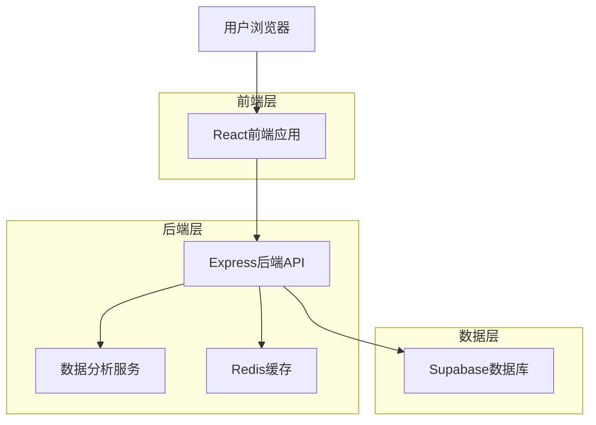
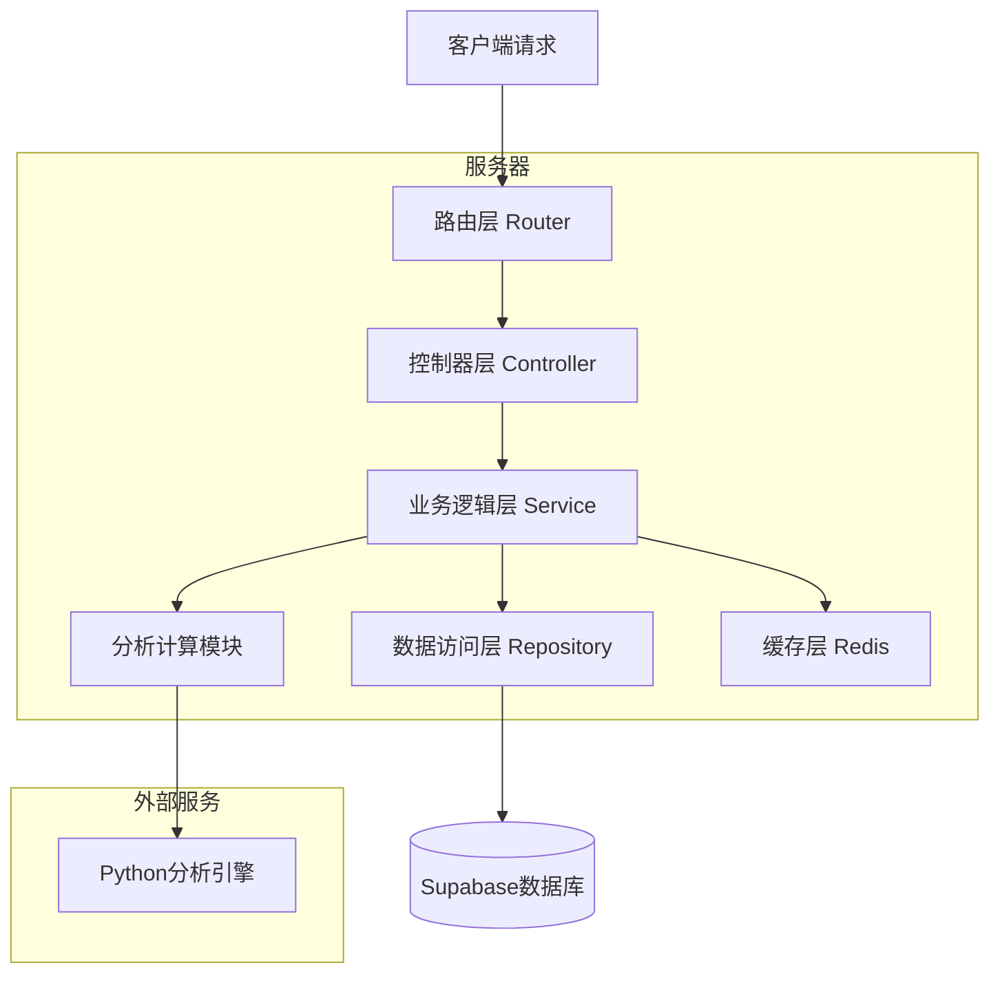
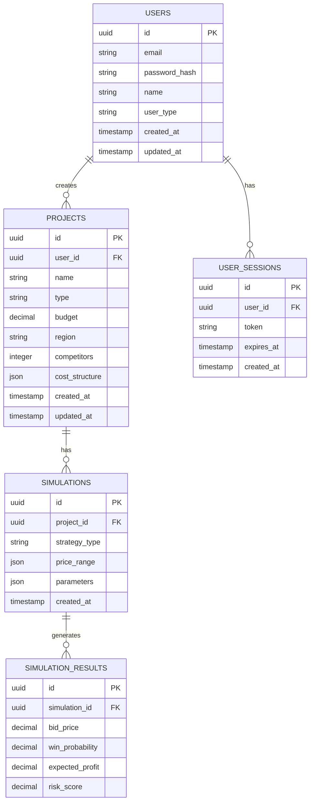

# 投标价格模拟器 - 技术架构文档

## 1. Architecture design



## 2. Technology Description

* Frontend: React\@18 + TypeScript + Tailwind CSS + Chart.js + Vite

* Backend: Express\@4 + TypeScript + Node.js

* Database: Supabase (PostgreSQL)

* Cache: Redis

* Analytics: Python数据分析模块 (pandas, numpy, scikit-learn)

## 3. Route definitions

| Route                 | Purpose        |
| --------------------- | -------------- |
| /                     | 首页，产品介绍和快速模拟入口 |
| /login                | 用户登录页面         |
| /register             | 用户注册页面         |
| /dashboard            | 用户仪表板，显示个人数据概览 |
| /project/new          | 新建项目设置页面       |
| /project/:id/simulate | 项目模拟分析页面       |
| /history              | 历史记录管理页面       |
| /data-management      | 数据管理页面（企业用户）   |
| /profile              | 用户个人资料设置       |

## 4. API definitions

### 4.1 Core API

**用户认证相关**

```
POST /api/auth/login
```

Request:

| Param Name | Param Type | isRequired | Description |
| ---------- | ---------- | ---------- | ----------- |
| email      | string     | true       | 用户邮箱        |
| password   | string     | true       | 用户密码        |

Response:

| Param Name | Param Type | Description |
| ---------- | ---------- | ----------- |
| success    | boolean    | 登录状态        |
| token      | string     | JWT认证令牌     |
| user       | object     | 用户信息        |

**项目管理相关**

```
POST /api/projects
```

Request:

| Param Name  | Param Type | isRequired | Description |
| ----------- | ---------- | ---------- | ----------- |
| name        | string     | true       | 项目名称        |
| type        | string     | true       | 项目类型        |
| budget      | number     | true       | 项目预算        |
| region      | string     | true       | 项目地区        |
| competitors | number     | true       | 竞争对手数量      |

Response:

| Param Name | Param Type | Description |
| ---------- | ---------- | ----------- |
| success    | boolean    | 创建状态        |
| projectId  | string     | 项目ID        |

**模拟分析相关**

```
POST /api/simulate
```

Request:

| Param Name | Param Type | isRequired | Description |
| ---------- | ---------- | ---------- | ----------- |
| projectId  | string     | true       | 项目ID        |
| priceRange | object     | true       | 价格范围设置      |
| strategy   | string     | true       | 投标策略        |

Response:

| Param Name     | Param Type | Description |
| -------------- | ---------- | ----------- |
| success        | boolean    | 模拟状态        |
| results        | array      | 模拟结果数据      |
| recommendation | object     | 推荐策略        |

Example:

```json
{
  "projectId": "proj_123",
  "priceRange": {
    "min": 1000000,
    "max": 1500000,
    "step": 10000
  },
  "strategy": "conservative"
}
```

## 5. Server architecture diagram



## 6. Data model

### 6.1 Data model definition



### 6.2 Data Definition Language

**用户表 (users)**

```sql
-- 创建用户表
CREATE TABLE users (
    id UUID PRIMARY KEY DEFAULT gen_random_uuid(),
    email VARCHAR(255) UNIQUE NOT NULL,
    password_hash VARCHAR(255) NOT NULL,
    name VARCHAR(100) NOT NULL,
    user_type VARCHAR(20) DEFAULT 'basic' CHECK (user_type IN ('basic', 'enterprise', 'admin')),
    created_at TIMESTAMP WITH TIME ZONE DEFAULT NOW(),
    updated_at TIMESTAMP WITH TIME ZONE DEFAULT NOW()
);

-- 创建索引
CREATE INDEX idx_users_email ON users(email);
CREATE INDEX idx_users_type ON users(user_type);

-- 设置权限
GRANT SELECT ON users TO anon;
GRANT ALL PRIVILEGES ON users TO authenticated;
```

**项目表 (projects)**

```sql
-- 创建项目表
CREATE TABLE projects (
    id UUID PRIMARY KEY DEFAULT gen_random_uuid(),
    user_id UUID NOT NULL REFERENCES users(id) ON DELETE CASCADE,
    name VARCHAR(200) NOT NULL,
    type VARCHAR(50) NOT NULL,
    budget DECIMAL(15,2) NOT NULL,
    region VARCHAR(100) NOT NULL,
    competitors INTEGER DEFAULT 3,
    cost_structure JSONB,
    created_at TIMESTAMP WITH TIME ZONE DEFAULT NOW(),
    updated_at TIMESTAMP WITH TIME ZONE DEFAULT NOW()
);

-- 创建索引
CREATE INDEX idx_projects_user_id ON projects(user_id);
CREATE INDEX idx_projects_type ON projects(type);
CREATE INDEX idx_projects_region ON projects(region);

-- 设置权限
GRANT SELECT ON projects TO anon;
GRANT ALL PRIVILEGES ON projects TO authenticated;
```

**模拟记录表 (simulations)**

```sql
-- 创建模拟记录表
CREATE TABLE simulations (
    id UUID PRIMARY KEY DEFAULT gen_random_uuid(),
    project_id UUID NOT NULL REFERENCES projects(id) ON DELETE CASCADE,
    strategy_type VARCHAR(50) NOT NULL,
    price_range JSONB NOT NULL,
    parameters JSONB,
    created_at TIMESTAMP WITH TIME ZONE DEFAULT NOW()
);

-- 创建索引
CREATE INDEX idx_simulations_project_id ON simulations(project_id);
CREATE INDEX idx_simulations_created_at ON simulations(created_at DESC);

-- 设置权限
GRANT SELECT ON simulations TO anon;
GRANT ALL PRIVILEGES ON simulations TO authenticated;
```

**模拟结果表 (simulation\_results)**

```sql
-- 创建模拟结果表
CREATE TABLE simulation_results (
    id UUID PRIMARY KEY DEFAULT gen_random_uuid(),
    simulation_id UUID NOT NULL REFERENCES simulations(id) ON DELETE CASCADE,
    bid_price DECIMAL(15,2) NOT NULL,
    win_probability DECIMAL(5,4) NOT NULL,
    expected_profit DECIMAL(15,2) NOT NULL,
    risk_score DECIMAL(5,4) NOT NULL
);

-- 创建索引
CREATE INDEX idx_simulation_results_simulation_id ON simulation_results(simulation_id);
CREATE INDEX idx_simulation_results_win_probability ON simulation_results(win_probability DESC);

-- 设置权限
GRANT SELECT ON simulation_results TO anon;
GRANT ALL PRIVILEGES ON simulation_results TO authenticated;
```

**初始化数据**

```sql
-- 插入示例用户
INSERT INTO users (email, password_hash, name, user_type) VALUES
('admin@example.com', '$2b$10$example_hash', '系统管理员', 'admin'),
('demo@example.com', '$2b$10$example_hash', '演示用户', 'basic');

-- 插入示例项目类型配置
INSERT INTO projects (user_id, name, type, budget, region, competitors, cost_structure)
SELECT 
    (SELECT id FROM users WHERE email = 'demo@example.com'),
    '示例建筑项目',
    '建筑工程',
    5000000.00,
    '北京',
    5,
    '{"material_cost": 0.6, "labor_cost": 0.25, "overhead": 0.1, "profit_margin": 0.05}'::jsonb;
```

